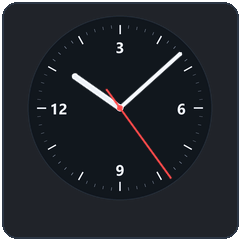
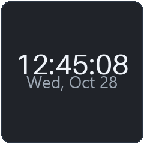
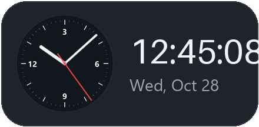
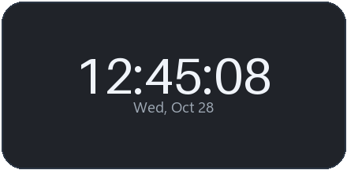
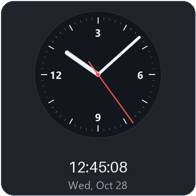
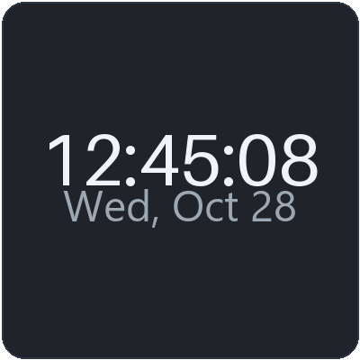
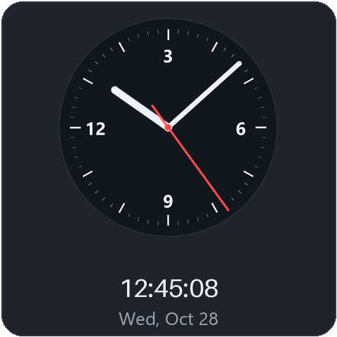
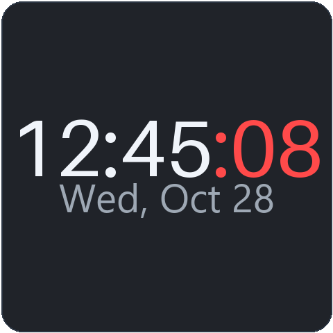

# Seconds Clock — Android home-screen clock widgets

Clock widgets for Android (1×1, 2×1, 2×2, 3×3) with **analog & digital faces** — and a **live seconds
hand / seconds digits**, tuned for OnePlus (15) and Samsung (Galaxy S23 Ultra) home screens.

| Size | Analog face | Digital face |
|------|-------------|--------------|
| 1×1  | mini dial with seconds hand | `12:45:08` + date |
| 2×1  | dial + digital time | large `12:45:08` |
| 2×2  | dial with seconds hand + `12:45:08` | big `12:45:08` |
| 3×3  | large dial + `12:45:08` | huge `12:45` with red flowing `:08` |

## Previews

| 1×1 | 2×1 | 2×2 | 3×3 |
|-----|-----|-----|-----|
|   |   |   |   |

## Install

Grab the signed APK from [Releases](https://github.com/ugoyel/seconds-clock/releases/latest)
(`seconds-clock-v1.0.0.apk`) or clone & build it yourself:

```bash
./gradlew assembleDebug   # APK: app/build/outputs/apk/debug/app-debug.apk
```

Requires JDK 17 and the Android SDK (API 34) — `local.properties` points to your SDK location.
The APK is debug-signed, so installing it alongside any Play-Store clock app works out of the box.

### Getting seconds to actually tick on OnePlus / Samsung

Digital faces are auto-updating (`TextClock`) — they need nothing special. The analog faces tick
through a lightweight foreground service (1 Hz, paused when the screen is off). OEM battery killers
are the usual reason a seconds hand freezes:

1. In the app, tap **Battery optimization settings** and allow *"Don't optimize"* for Seconds Clock.
2. Then disable background limits for the app:
   - **OnePlus/ColorOS 15**: Settings → Apps → Seconds Clock → enable Auto-launch + *Don't optimize*.
   - **Samsung/OneUI (S23 Ultra)**: Battery → Background usage limits → add *Seconds Clock* to
     **Never sleeping apps** (the in-app *Auto-launch* button tries to open that screen directly).
3. Optional: tap **Restart clock service & refresh widgets** after rebooting.

## Usage

- Long-press your launcher → *Widgets* → *Seconds Clock*, pick a size/face, or use the in-app
  **Add** buttons to pin widgets directly.
- Every widget has a configuration dialog: choose **Analog/Digital** and
  **system / 24-hour / 12-hour** format.
- Tap any widget to open the app (face picker there applies to new widgets).

## How it works

- **Digital faces** — `TextClock` with `HH:mm:ss` renders itself every second; no background work.
- **Analog faces** — the second/minute/hour hands are stacked `ImageView`s rotated
  (`RemoteViews.setFloat(view, "setRotation", …)`) by a `foregroundServiceType=specialUse`
  service that fires once per second, aligned to the wall clock, and sleeps with the screen.
- Bootstrap on `BOOT_COMPLETED` / `MY_PACKAGE_REPLACED`; math anchored per-widget so multiple
  widgets on one home screen stay in sync.

Project layout:

```
app/src/main/java/com/secondsclock/
  MainActivity, WidgetConfigActivity
  widget/  Clock{1x1,1x2,2x2,3x3} providers (+ base ClockWidgetProvider)
  store/   Store (prefs), WidgetData (RemoteViews builder)
  service/ ClockTickService (1 Hz ticker)
  receiver/BootReceiver
app/src/main/res/  layouts per size+face, widget info xml
tools/gen_assets.py  generates dial/hands/icons/previews (Pillow)
```

MIT licensed.
